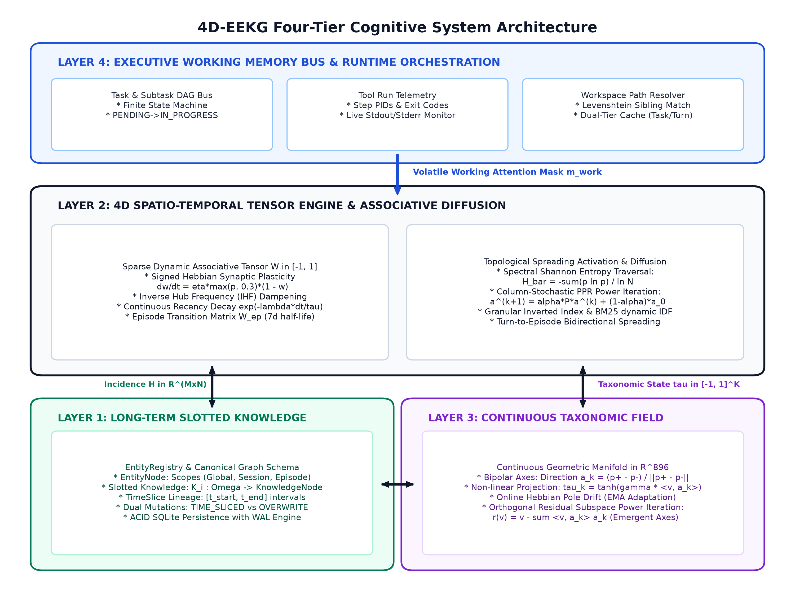

# Tenor (4D-EEKG Memory Architecture)

[](LICENSE)
[](docs/RESEARCH_PAPER.md)
[](pyproject.toml)
[](https://exortic.com)

**Tenor** is a four-tier spatio-temporal memory architecture engineered for autonomous AI agents. 

Rather than relying on flat vector databases, naive top-k semantic similarity, or brute-force million-token context windows, Tenor implements an integrated **Episodic-Entity Knowledge Graph (4D-EEKG)** with signed associative plasticity, continuous taxonomic manifolds, and volatile working memory orchestration.

> Read the full scientific report: [**docs/RESEARCH_PAPER.md**](docs/RESEARCH_PAPER.md)  
> Download Word manuscript: [**docs/research_paper_4d_eekg_memory_architecture.docx**](docs/research_paper_4d_eekg_memory_architecture.docx)

---

## The Problem: AI Amnesia & The Limits of RAG

Every autonomous agent running in production today hits the exact same walls:
1. **The KV-Cache Wall**: Storing raw 1M-token context buffers consumes over 130 GB of VRAM per session on 70B models. Re-reading entire conversation transcripts on every prompt is computationally unsustainable.
2. **Semantic Similarity Is Not Truth**: Vector search returns text that *sounds* similar, not what is factually true or currently valid. It cannot handle state mutations (e.g., when a user migrates from Postgres to ClickHouse on Day 4, vector search still returns the Day 1 Postgres recommendation).
3. **Temporal Blindness**: Vector embeddings live in high-dimensional spatial geometry with zero chronological awareness, cause-and-effect reasoning, or dynamic forgetting.
4. **Graph Explosion ("Hairballs")**: Unconstrained symbolic knowledge graphs explode around high-degree hub nodes, diluting graph diffusion queries.

Tenor replaces discrete prompt stuffing with a continuous **spatio-temporal substrate**.

---

## The Four-Tier System Architecture

```
┌────────────────────────────────────────────────────────────────────────┐
│                      TIER 4: EXECUTIVE WORKING MEMORY                  │
│   Task DAGs • Tool Execution Telemetry • Slotted Quota Context Packer   │
└────────────────────────────────────┬───────────────────────────────────┘
                                     │ Biases & Activates
┌────────────────────────────────────▼───────────────────────────────────┐
│                  TIER 2: 4D SPATIO-TEMPORAL TENSOR ENGINE              │
│   Signed Hebbian Plasticity ([-1.0, 1.0]) • Speaker Attribution        │
│   Inverse Hub Frequency (IHF) • Personalized PageRank Spreading Diff   │
└──────────────────┬──────────────────────────────────┬──────────────────┘
                   │ Anchors                          │ Projects
┌──────────────────▼───────────────────┐ ┌────────────▼───────────────────┐
│  TIER 1: SLOTTED ENTITY KNOWLEDGE    │ │ TIER 3: CONTINUOUS TAXONOMY   │
│  TimeSlice Intervals [t_s, t_e]      │ │ R^896 Manifold (tanh)         │
│  Dual-Path Mutation & Invalidation   │ │ Online EMA Residual Discovery │
└──────────────────────────────────────┘ └───────────────────────────────┘
```

### 1. Tier 1: Declarative Slotted Entity Knowledge
* **Immutable TimeSlice Intervals**: Every attribute update is stored as a closed interval $[t_{\text{start}}, t_{\text{end}}]$, ensuring mathematical invariance over updates and full auditability of historical state without data destruction.
* **Dual Update Pathways**: Supports explicit, non-destructive versioned historical branching alongside verified in-place overwrites.
* **Deterministic Dual-Factor Entity Resolution**: Matches entities via unified lexical surface boundaries and dense 896-dimensional unit representations.

### 2. Tier 2: 4D Spatio-Temporal Tensor Engine
* **Signed Hebbian Plasticity**: Online associative updates bounded strictly in $[-1.0, 1.0]$ with asymmetric diminishing saturation ($+1.0$ for confirmed associations, accelerated suppression toward $-1.0$ for invalidations).
* **Speaker Attribution Isolation**: Eliminates opinion contamination between agents and users by strictly excluding listeners from associative co-occurrence edge formation.
* **Inverse Hub Frequency (IHF)**: Dampens degree explosion mathematically without arbitrary stopword lists or ad-hoc heuristic thresholds.
* **Personalized PageRank Diffusion**: Spreading activation modulated dynamically by the **Spectral Shannon Entropy** of query seed distributions (concentrated factual queries execute sharp local retention; diffuse exploratory queries trigger multi-hop topological diffusion).

### 3. Tier 3: Emergent Continuous Taxonomic Manifold
* **Non-Discrete Classification**: Replaces rigid enum labels with continuous semantic vectors ($\tau \in \mathbb{R}^{896}$).
* **Adaptive Bipolar Anchors**: Centroid poles update online via exponential moving averages (EMA).
* **Autonomous Axis Discovery**: Extracts emergent conceptual dimensions through orthogonal residual power iteration.

### 4. Tier 4: Volatile Executive Working Memory
* **Task Directed Acyclic Graphs (DAG)**: Coordinates hierarchical subtask states, progress flags, and active execution barriers.
* **Tool Telemetry Feedback**: Dynamically links execution failures back to long-term memory for retroactive invalidation.
* **Deterministic Slotted Quotas**: Assembles prompt context strictly within a sub-350-token budget (50% direct entity facts, 30% topological associations, 20% recent episodic turns).

---

## Architectural Flowchart



---

## Repository Structure

```
tenor/
├── docs/
│   ├── figures/               # Architectural diagrams & empirical scaling curves
│   │   ├── fig1_system_topology.png
│   │   ├── fig2_retrieval_pipeline.png
│   │   ├── fig3_hebbian_saturation.png
│   │   ├── fig4_temporal_decay.png
│   │   ├── fig5_spectral_entropy.png
│   │   └── fig6_memory_scaling.png
│   ├── RESEARCH_PAPER.md     # Full academic preprint in Markdown
│   └── research_paper_4d_eekg_memory_architecture.docx
├── tenor/                     # Core Python Architecture Package
│   ├── __init__.py            # Package entrypoint & module definitions
│   ├── embedder.py            # Dense embedding provider (896-dim unit vectors)
│   ├── llm_client.py          # Zero-dependency resilient HTTP inference client
│   ├── llm_manager.py         # LLM-in-the-loop state structuring & query parsing
│   ├── nlp_extractor.py       # Linguistic filtering & pattern-based mutation detector
│   ├── node_models.py         # KnowledgeNode, EntityRegistry & TimeSlice intervals
│   ├── orchestrator.py        # Central memory lifecycle & retrieval controller
│   ├── taxonomy.py            # Continuous R^896 taxonomic field & residual discovery
│   ├── tensor_engine.py       # 4D Spatio-Temporal tensor, Hebbian learning & PageRank
│   ├── turn_extractor.py      # Dialogue turn salience parser & temporal binder
│   ├── working_memory.py      # Volatile working memory, task DAG & slotted quotas
│   └── workspace_resolver.py  # Local directory & persistent state serialization
├── pyproject.toml             # Python build configuration
├── LICENSE                    # MIT License
└── README.md
```

---

## Quickstart

### Installation

```bash
git clone https://github.com/exorticlabs/tenor.git
cd tenor
pip install -e .
```

### Basic Usage

```python
from tenor.orchestrator import MemoryOrchestrator
from tenor.working_memory import WorkingMemoryBus

# 1. Initialize the memory substrate
memory = MemoryOrchestrator(
    storage_dir="./memory_store",
    embedding_dim=896
)

# 2. Record an interaction with strict speaker attribution
memory.process_turn(
    turn_id=1,
    speaker="user",
    text="We are migrating our primary database from Postgres to ClickHouse for analytics.",
    timestamp=1730000000.0
)

# 3. Retrieve context with dynamic entropy-modulated diffusion
context = memory.query(
    query_text="Which database should we write this analytical migration script for?",
    token_budget=350
)

print(context)
# Returns ClickHouse as current ground truth with invalidated historical Postgres TimeSlice
```

---

## Research & Citation

If you build upon or utilize the 4D-EEKG architecture in your research, please cite:

```bibtex
@article{exortic2026tenor,
  title={4D-EEKG: A Four-Tier Spatio-Temporal Episodic-Entity Knowledge Graph Architecture with Signed Associative Plasticity and Emergent Continuous Taxonomic Manifolds},
  author={{Exortic Research Lab}},
  journal={Exortic Cognitive Systems & Autonomous Agent Foundations Report},
  year={2026},
  url={https://github.com/exorticlabs/tenor}
}
```

---

## License

This project is licensed under the **MIT License** — see the [LICENSE](LICENSE) file for details.
